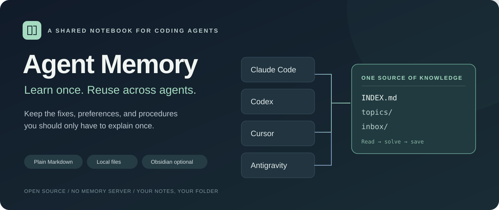
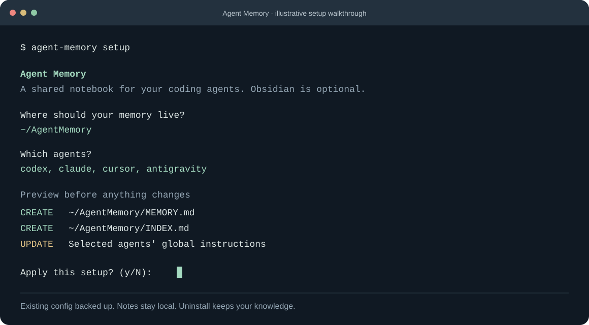

<p align="center">
  
</p>

<p align="center">
  <a href="https://github.com/Ameer-Jamal/agent-memory/actions/workflows/ci.yml"></a>
  <a href="LICENSE"></a>
  
  
</p>

# Agent Memory

**Learn once. Reuse across agents.**

Give your coding agents a shared Markdown notebook for fixes, preferences, and procedures. When you switch tools or start a fresh chat, useful discoveries have somewhere to live.

Works with **Claude Code, Codex, Cursor, and Antigravity**. Use a regular folder, your existing Markdown notes, or an Obsidian vault. No Obsidian plugin is required.

[Get started](#get-started) · [See how it works](#how-it-works) · [Compatibility](docs/compatibility.md) · [Troubleshooting](docs/troubleshooting.md) · [Contribute](CONTRIBUTING.md)

## Why use it?

You solve a tricky local setup issue with one agent. Tomorrow, another agent hits the same error and starts from scratch. Or you repeat the same preference in every new chat.

Agent Memory gives that knowledge a home and adds short instructions telling each agent **when to look it up and when to save a lesson**.

| Without shared notes | With Agent Memory |
| --- | --- |
| Explain the same setup across tools | Point selected agents at one notebook |
| Rediscover the same environment fix | Keep the symptom, scope, fix, and evidence |
| Lose useful corrections in long chats | Save concise, searchable lessons |
| Copy a huge instruction file everywhere | Load a short index, then relevant topics |
| Wonder whether memory works | Run an explicit discovery and capture test |

For example: an agent discovers that a local test runner needs a particular Java version. It records the symptom, confirmed fix, project scope, and verification. A future agent can find the note before trying the same failing command.

**This is file-based memory, not model training.** Following the instructions depends on the agent, its version, and its permissions. The installer checks configuration; the guided test checks actual behavior.

## Get started

You need **[Node.js 22+](https://nodejs.org/)** and **[Git](https://git-scm.com/downloads)**. The installer has no runtime dependencies. Your chosen coding agents still need to be installed and signed in separately.

```sh
npm install --global git+https://github.com/Ameer-Jamal/agent-memory.git
agent-memory setup
```

The package is installed directly from this GitHub repo; an npm registry release is not required. Prefer to inspect the source first? [Run from a clone](docs/getting-started.md#run-from-source).

The wizard walks you through:

1. **Choose a memory folder.** Default: `~/AgentMemory`. An empty subfolder in an Obsidian vault works too.
2. **Choose your agents.** Existing agent configuration folders are detected as suggestions.
3. **Optionally connect existing notes.** Specify a folder agents may consult when curated memory has no answer. Files are referenced, not imported.
4. **Review the changes.** See every file the installer plans to create or update. Existing config files are backed up before changes.
5. **Complete agent-specific steps and test.** Cursor needs its global User Rule checked in the app. File access may require a scoped permission grant.



*Illustrative walkthrough; paths and available agents depend on your machine.*

### Already use Obsidian?

Choose a **new subfolder** inside your vault, such as `My Vault/Agent Memory`. The installer suggests registered vaults when it can find them. All notes are ordinary Markdown, so they remain editable without Obsidian.

### Prefer an explicit command?

```sh
agent-memory setup --agents codex,claude --memory-dir "~/AgentMemory" --dry-run
```

Remove `--dry-run` and add `--yes` to apply noninteractively. Add `--allow-capture` only if you want the installer to allow Claude's built-in file tools to save Markdown inside the memory inbox. It does not grant shell access.

## How it works

```text
Your agent's global instructions
             |
             v
        MEMORY.md          When to read, what to save, what to verify
             |
             v
         INDEX.md          Short topic list
          /    \
         v      v
     topics/  inbox/       Curated procedures + recent discoveries
                  ^
                  |
          New useful lesson
```

The installer adds a clearly marked block to each supported instruction file. The real policy stays in the shared folder. Each agent creates a separate inbox note to reduce conflicts; the index is updated during deliberate cleanup.

```text
AgentMemory/
  MEMORY.md
  INDEX.md
  topics/
  inbox/
  templates/
    lesson.md
```

Lessons include **scope, symptom, cause, fix or preference, evidence, source, and verification date**. User preferences are labeled user-stated; untested advice stays unverified. The notebook begins without any personal or machine-specific facts.

## Verify it works

```sh
agent-memory doctor
agent-memory test
```

`doctor` checks files and shows manual steps. It makes no model calls and does not claim your agents have used memory.

`test` creates a temporary fictional note and prints two prompts for a **fresh agent chat**:

- Find a random preflight phrase without being told its answer or file path.
- Save a clearly marked test-only lesson to the shared inbox.

Then run:

```sh
agent-memory test check
agent-memory test clean
```

The check compares the phrase you paste with the hidden expected value and verifies a new matching lesson exists on disk. Cleanup removes only unchanged, identified test files. Repeat with each agent, or ask a different fresh agent to retrieve the note to test sharing. [Full testing guide](docs/testing.md).

## Commands

| Command | Purpose |
| --- | --- |
| `agent-memory setup` | Guided installation and preview |
| `agent-memory doctor` | Configuration health and manual steps |
| `agent-memory instructions cursor` | Print the pointer to paste into Cursor User Rules |
| `agent-memory test` | Prepare a private discovery/capture challenge |
| `agent-memory test check` | Verify the answer and actual saved lesson |
| `agent-memory test clean` | Clean identified, unchanged test notes |
| `agent-memory uninstall` | Remove managed integration; keep your notes |

Run `agent-memory --help` for explicit paths, agent selection, JSON output, and dry runs.

## Privacy and control

- **No server, account, telemetry, or background process for Agent Memory.** The CLI uses local files and does not call a model or upload your notes. Installation fetches code from GitHub through npm.
- **Your chosen AI provider still processes what its agent reads.** Local storage does not make a cloud model offline or private from its provider.
- **Private by default.** The generated memory folder has a Git ignore rule for its contents. Keep personal notes out of public repos; deliberately review any team notes you choose to share.
- **No secrets in lessons.** The policy excludes credentials and sensitive logs. This is an instruction, not an automatic secret scanner.
- **Reversible setup.** Marked blocks, local backups, duplicate detection, atomic file writes, and rollback on normal write failures protect existing config. Later edits outside managed blocks are preserved on uninstall.
- **No broad permission bypass.** Read-only sessions stay read-only. Agent sandboxes and existing restrictions still apply.

See [security and data handling](SECURITY.md) for scope and recovery details.

## Compatibility and limits

The CLI uses cross-platform Node APIs. CI runs its filesystem and command tests on **macOS, Windows, and Linux** with Node 22 and 24. Real model behavior must be tested in your installed agent versions.

| Agent | Connection | What to check |
| --- | --- | --- |
| Claude Code | Global `CLAUDE.md` block | File access; optional inbox-only capture permission |
| Codex | Global `AGENTS.md` block; respects `CODEX_HOME` | Overrides and writable access to inbox |
| Cursor | Local user-rule file plus global User Rule instructions | Paste/check the account User Rule in the app |
| Antigravity | Global `GEMINI.md` block | Allow reads for memory and writes for inbox when prompted |

This release supports default local agent configuration layouts, with `CODEX_HOME` honored for Codex. Custom profiles and remote runtimes may need manual setup. It does not configure generic web chats, completion-only features, cloud mounts, or syncing. [Detailed compatibility and official references](docs/compatibility.md).

## Maintain your notebook

Ask an agent:

> Review my shared memory inbox. Merge verified reusable lessons into topics, preserve scope and evidence, update INDEX, and flag stale or conflicting advice.

No cleanup is scheduled automatically. Keep topics small, review old procedures, and scope machine-specific fixes carefully.

## Development

```sh
git clone https://github.com/Ameer-Jamal/agent-memory.git
cd agent-memory
npm ci
npm run verify
```

Tests run against isolated temporary homes, never your real agent configs. See [CONTRIBUTING.md](CONTRIBUTING.md) for the adapter and safety conventions.

## Support

[Report a bug](https://github.com/Ameer-Jamal/agent-memory/issues/new?template=bug_report.yml) · [Suggest an improvement](https://github.com/Ameer-Jamal/agent-memory/issues/new?template=feature_request.yml)

[MIT](LICENSE) © Ameer Jamal. Independent community project; not affiliated with the agent vendors.
